**English** | [简体中文](./README.zh-CN.md)

<div align="center">

<a href="#quickstart"></a>

### Leasekeeper is the lease broker that stops parallel coding agents from deadlocking.

[](https://go.dev)
[](https://github.com/SuperMarioYL/leasekeeper/releases)
[](./LICENSE)
[](https://github.com/SuperMarioYL/leasekeeper/releases)
[](https://github.com/SuperMarioYL/leasekeeper/actions/workflows/ci.yml)

<picture>
  <source media="(prefers-color-scheme: dark)" srcset="./assets/presentation/hero-dark.svg" />
  <source media="(prefers-color-scheme: light)" srcset="./assets/presentation/hero-light.svg" />
  
</picture>

</div>

---

## Why this exists

You start a refactor, a test run and a GPU job against the same checkout. Each one wants a file, a port or a slice of quota, and nothing forces any of them to hold exclusive ownership before it writes. Two agents that each take half of a resource pair can wait on each other forever, and you find out when one of them stops producing output.

The usual recovery is manual and after the fact: notice the collision, diff the damage, re-run the lost work, or give up and serialise the agents by hand.

Leasekeeper makes ownership explicit and makes the circular wait impossible to enter:

- **A lease** is time-bounded exclusive ownership of one named resource — a file, a port, a GPU, or a quota slot. An agent acquires it, holds it, and releases it.
- **A wait-for graph** records who is waiting on whom. When an acquire would close a loop, it is refused and the cycle is printed, instead of both agents blocking until someone notices.

That second part is the whole product. A per-action guard can authorise or hide a file, and a `flock` can cover one resource in one process tree, but neither builds the cross-agent graph that a cycle is visible in.

## Quickstart

Install the binary, then run the built-in demo. It needs no configuration and no second terminal: it starts a broker on a temporary socket and plays the two-agent cycle end to end.

```bash
go install github.com/SuperMarioYL/leasekeeper/cmd/leasekeeper@latest

leasekeeper demo
```

The same story with two real agent processes in two terminals, using the example scripts shipped in this repo:

```bash
git clone https://github.com/SuperMarioYL/leasekeeper.git
cd leasekeeper
go build -o leasekeeper ./cmd/leasekeeper
export PATH="$PWD:$PATH"   # so the example scripts find the binary
```

Terminal 1 — agent a takes `file:src/a.go`, then waits for `port:8080`:

```bash
leasekeeper run --name a -- ./examples/agent-a.sh
```

Terminal 2 — agent b takes `port:8080`, then asks for agent a's file:

```bash
leasekeeper run --name b -- ./examples/agent-b.sh
```

Or run both agents against one broker from a single terminal:

```bash
./examples/two-agents.sh
```

## Demo

<picture>
  <source media="(prefers-color-scheme: dark)" srcset="./assets/demo.gif" />
   a -> b." width="100%" />
</picture>

The recording is `leasekeeper demo --pause 3s` — the same run as `leasekeeper demo`, paced so each step is readable. The moment it exists for is the fourth step, where agent b's second acquire is refused:

```console
[b] acquire file:src/a.go
     acquire denied  acquire denied — would deadlock: b -> a -> b
```

A refused acquire exits non-zero, so a script can branch on it instead of hanging.

The full recorded transcript, with the exact command that produced it and the implementation revision, is in [`docs/demo-results.json`](./docs/demo-results.json).

<details>
<summary>Full recorded output of <code>leasekeeper demo</code></summary>

```console
$ leasekeeper demo
Leasekeeper demo — two agents, one resource pair, one refused cycle
broker started on a temporary socket; no configuration needed

  [a] acquire file:src/a.go
     granted  granted file:src/a.go to a

  [b] acquire port:8080
     granted  granted port:8080 to b

  [a] acquire port:8080   (blocks)
     waiting  waiting for port:8080 held by b

  [b] acquire file:src/a.go
     acquire denied  acquire denied — would deadlock: b -> a -> b

Leases
  RESOURCE       OWNER  HELD  TTL
  file:src/a.go  a      0s    -
  port:8080      b      0s    -

Wait-for graph
  a -> b

  [b] release port:8080
     released  released port:8080
     granted  granted port:8080 to a after waiting

Leases
  none held

Wait-for graph
  no agent is waiting on another

a held half the pair and b held the other half, so the second acquire was refused
instead of hanging. Nothing was preempted: the refusal failed fast, and once b
released the port the queued waiter was served in order.
```

</details>

## How it works

One Go binary, three modes, no database and no long-lived daemon.

```
leasekeeper (single binary)
├── broker   one process per run session; Unix socket; owns Table + WaitGraph in memory
├── client   thin RPC the CLI and the agent shim both use (acquire / release / status)
└── cli      run (start broker + spawn child) · acquire · release · status · demo
```

<picture>
  <source media="(prefers-color-scheme: dark)" srcset="./assets/presentation/architecture-dark.svg" />
  <source media="(prefers-color-scheme: light)" srcset="./assets/presentation/architecture-light.svg" />
  
</picture>

The broker owns the lease table and the wait-for graph; everything else is a caller. `run` starts a broker if none is listening and wraps your command, so the agent reaches it through `LEASEKEEPER_SOCKET` with no code change beyond calling `acquire` and `release`.

Here is what one acquire does:

<picture>
  <source media="(prefers-color-scheme: dark)" srcset="./assets/presentation/process-dark.svg" />
  <source media="(prefers-color-scheme: light)" srcset="./assets/presentation/process-light.svg" />
  
</picture>

1. **Declare the resource.** The caller names it; nothing is discovered.
2. **Read the lease table.** Free means grant, and the owner is recorded.
3. **Check the wait-for graph.** If someone else holds it, would making this agent wait close a loop?
4. **Grant, queue or refuse.** A safe wait is recorded and the agent is queued behind the holder, first in, first out. A wait that would close a cycle is refused, and the cycle is printed.

<picture>
  <source media="(prefers-color-scheme: dark)" srcset="./assets/presentation/integrations-dark.svg" />
  <source media="(prefers-color-scheme: light)" srcset="./assets/presentation/integrations-light.svg" />
  
</picture>

## Usage

| Command | What it does |
| --- | --- |
| `leasekeeper run -- <command>` | Starts a broker if needed, runs the command with `LEASEKEEPER_SOCKET` and `LEASEKEEPER_AGENT` set, and hands back every lease the command still held when it exits. |
| `leasekeeper acquire <resource>` | Takes a lease. Blocks until the agent owns it, queueing behind the current holder. Exits non-zero if it is refused. |
| `leasekeeper release <resource>` | Hands a lease back. Only the holder may release it, and the first queued waiter is granted it. |
| `leasekeeper release --all` | Hands back everything this agent holds. |
| `leasekeeper status` | Prints the lease table and the current wait-for graph. |
| `leasekeeper demo` | Plays the two-agent cycle refusal on a temporary socket. |

Resource names carry their kind, so a path can never collide with a port number:

```
file:<path>     port:<n>     gpu:<id>     quota:<name>
```

```console
$ leasekeeper acquire file:src/a.go            # blocks until owned
$ leasekeeper acquire --ttl 5m port:8080       # lease expires after 5 minutes
$ leasekeeper acquire --no-wait port:8080      # report the holder and return
$ leasekeeper release file:src/a.go
$ leasekeeper status
```

### Flags and environment

| Flag | Applies to | Meaning |
| --- | --- | --- |
| `--agent <name>` | `acquire`, `release` | The agent identity the lease is attributed to. |
| `--ttl <duration>` | `acquire` | How long the lease stays valid, e.g. `5m`. `0` means held until released. |
| `--no-wait` | `acquire` | Report who holds the resource and exit, instead of queueing. |
| `--timeout <duration>` | `acquire` | How long to wait before giving up. Default `30s`. |
| `--socket <path>` | all | The broker socket. Defaults to `$LEASEKEEPER_SOCKET`, then a per-user path in the temp dir. |
| `--no-color` | all | Plain output. Colour also turns itself off when output is piped or `NO_COLOR` is set. |

| Variable | Set by | Meaning |
| --- | --- | --- |
| `LEASEKEEPER_SOCKET` | `run` | The socket the child agent talks to. |
| `LEASEKEEPER_AGENT` | `run` | The agent identity the child acquires leases as. |

## How it compares

Each of these owns something real. The last row is the part the others do not reach.

| Approach | What it owns | What happens when two agents want the same thing |
| --- | --- | --- |
| `git worktree` | A separate file tree per agent | Files stop colliding, but only files — ports, GPU and quota are outside it, and the file conflict moves to merge time. |
| Per-action guards (allow or hide a tool call) | Nothing: authorisation is per action and stateless | Both agents can still each hold half of a resource pair and wait. |
| `flock` and file locks | One resource in one process tree | A lock cannot see a cycle that spans two resources and two agents. |
| **Leasekeeper** | A named resource for a bounded time, plus the wait-for graph | The second acquire is refused with the cycle printed, and the queued waiter is served in order once the holder releases. |

## Limitations

Read these before adopting it. They are the boundaries the plan draws around v0.1.

- **The broker is one local process per run session on one host.** No distributed leases, no cross-machine coordination.
- **The agent, or its wrapper, has to call `acquire` and `release`.** Kernel-level interception of an unmodified agent (LD_PRELOAD, ptrace, seccomp) is out of scope, so `leasekeeper run -- <command>` is the seam.
- **GPU and quota are named resources leased by agreement.** Leasekeeper does not fence a driver, a CUDA runtime or VRAM.
- **If the broker dies, every lease drops.** That is deliberate: lease state is in memory, so no agent can hold a stale lease forever.
- **There is no preemption and no priority.** A refused acquire fails fast; it does not take the resource from the current holder.
- **There is no auto-discovery.** The caller declares the resources it needs.

## Roadmap

**Shipped in v0.1.0** — file, port, GPU and quota leases; `run`, `acquire`, `release`, `status` and `demo`; the wait-for graph with cycle refusal; TTL expiry; FIFO queueing; a session-counted broker that shuts down when the last run leaves.

**Open: the demand gate.** The plan puts a falsification gate in front of the product — cite two or more real collision or circular-wait incidents and run five developer interviews, with at least two reporting lost work. That gate has **not** passed: the evidence base is topic-level and cites no incident. [`docs/validation.md`](./docs/validation.md) records the count and the interview script, and the launch plan stays gated behind it. Nothing in this README claims validated demand, because it is exactly what has not been established.

**After the gate, not before.** Further work is a candidate, not a commitment, and is gated on the interviews: kernel-level interception so unmodified agents are covered, and quota accounting that turns the `quota:` resource from a name into a measured budget.

## License

<p align="center"><sub><a href="./LICENSE">MIT</a> © 2026 SuperMarioYL</sub></p>
